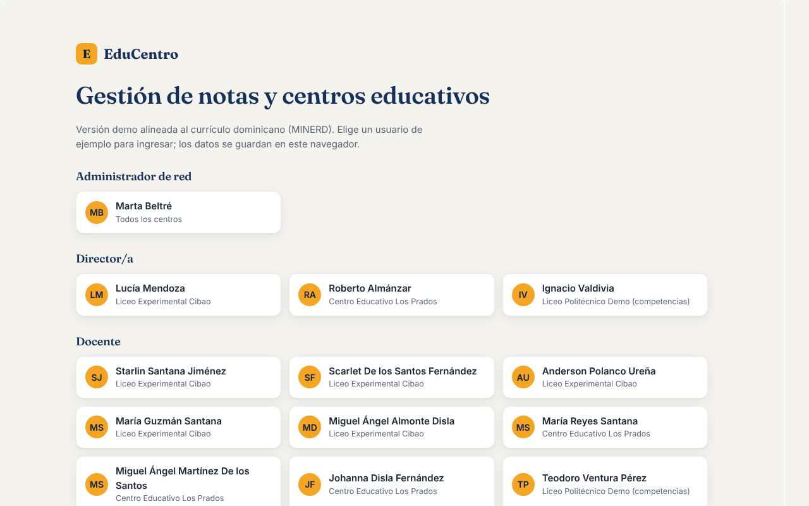

# EduCentro

EduCentro es una aplicación web de **gestión de notas y centros educativos** alineada al sistema educativo dominicano (MINERD): niveles Inicial, Primario y Secundario, escala 0–100 con nota mínima configurable (defecto 70), textos y fechas es-DO. Es una app estática (HTML, CSS y JavaScript clásico, sin build) que se abre por `file://` y guarda los datos en el navegador (`localStorage`). Hay un empaquetado Android con Capacitor en `mobile/`.

> **Estado: prototipo funcional con datos ficticios.** Todos los módulos están implementados. El control de acceso es solo del lado cliente: **no usar con datos reales de estudiantes hasta tener backend** (ver [Seguridad y privacidad](Seguridad-y-privacidad)).

## Qué incluye
- Red de centros, configuración (años, periodos, escala, secciones, asignaturas, cargas), personas, matrícula.
- Calificaciones con **dos modelos**: ponderado por categorías y **por competencias** (planilla MINERD con P1–P4, RP, completiva, extraordinaria y especial). Meritorios y completivos. Boletín imprimible y reportes.
- Importación y exportación de la planilla Excel del MINERD.
- Asistencia, comunicados, respaldo JSON.
- Horarios docentes, cursos y talleres, aula virtual (tareas, cuestionarios, foros).
- Currículo MINERD versionado (parcial), secuencias didácticas, planificación de clases.
- Agente IA con proveedor simulado y adaptador a backend real.

## Índice
| Página | Contenido |
|---|---|
| [Inicio rápido](Inicio-rapido) | Abrir la app, usuarios demo, restablecer datos, pruebas |
| [Arquitectura](Arquitectura) | Namespace `EDU`, capas, repo con adaptador, router |
| [Roles y permisos](Roles-y-permisos) | Matriz real leída de `permisos.js` |
| [Modelo de datos](Modelo-de-datos) | Colecciones y campos |
| [Reglas de cálculo](Reglas-de-calculo) | Ponderado y por competencias, con ejemplos |
| [Módulos](Modulos) | Una sección por módulo |
| [Currículo MINERD](Curriculo-MINERD) | Qué está verificado y qué no |
| [Agente IA](Agente-IA) | Modos, tareas, seguridad, backend |
| [Aula virtual](Aula-virtual) | Cursos virtuales por carga |
| [Horarios](Horarios) | Franjas, validaciones, propuesta automática |
| [Cursos y talleres](Cursos-y-talleres) | Cupos, lista de espera, inscripciones |
| [Planilla Excel y competencias](Planilla-Excel-y-competencias) | Modelo por competencias, importador y exportador |
| [App Android](App-Android) | Capacitor, pasos para el APK |
| [Seguridad y privacidad](Seguridad-y-privacidad) | Resumen de `docs/SEGURIDAD.md` |
| [Pruebas](Pruebas) | `tests/` y verificación con Playwright |
| [Decisiones y limitaciones](Decisiones-y-limitaciones) | Lo pendiente de verificar y los límites |
| [Backend](Backend) | Servidor Node + PostgreSQL: Fase 0 (autenticación) implementada |
| [Hoja de ruta](Hoja-de-ruta) | Fases pendientes |
| [Historial](Historial) | Cronología |

## Documentos fuente en el repositorio
`docs/PLAN.md`, `docs/API.md` (contrato técnico), `docs/BACKEND.md` (plan del servidor), `docs/CURRICULO-MINERD.md`, `docs/PLANTILLAS-CALIFICACION.md`, `docs/SEGURIDAD.md`. Esta wiki los resume; ante discrepancias, manda el código.

## Privacidad de esta wiki
Solo contiene datos de la semilla ficticia. Los datos reales (planilla de calificaciones) viven en `Educentro/datos-privados/`, ignorada por git, y no se describen aquí.
