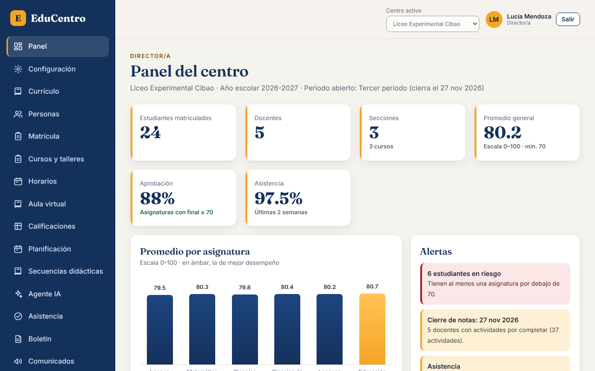
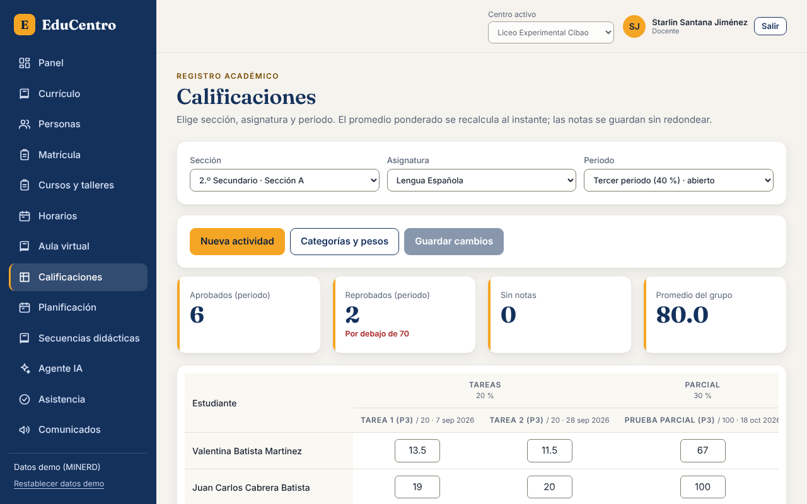
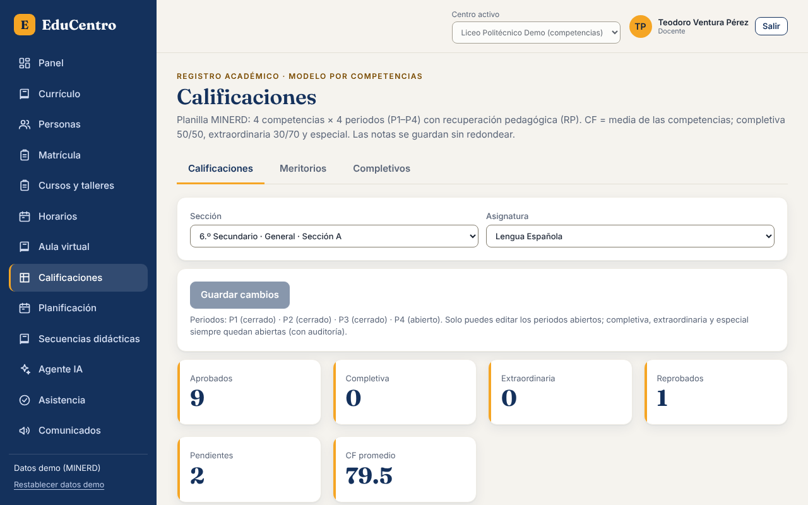
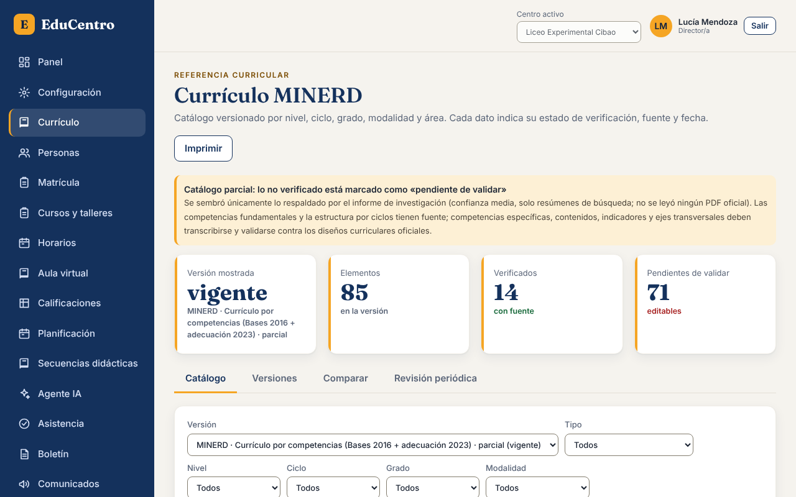
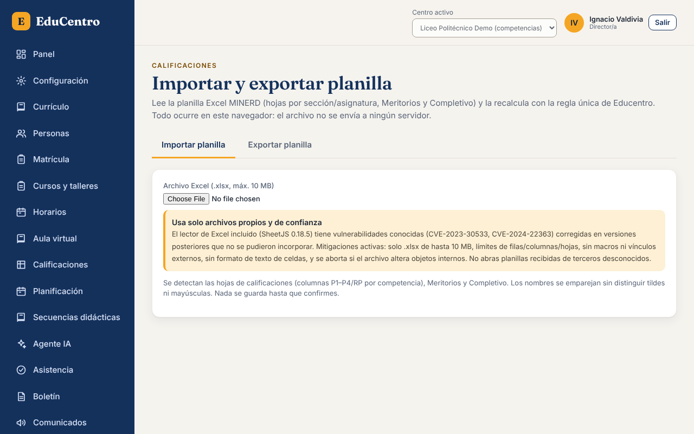

# Módulos

Todos los módulos del menú están implementados (no queda ningún stub "En construcción" en `js/`). Cada sección indica ruta, quién accede y qué hace. Permisos exactos en [Roles y permisos](Roles-y-permisos).

## Panel (`#/dashboard`)
KPIs por rol calculados de los datos reales, con el periodo abierto del centro.

## Centros educativos (`#/centros`) — admin_red
Red de centros en tarjetas, alta/edición/baja, detalle con KPIs y pestaña de **reporte consolidado** de la red.

## Configuración (`#/config`) — director (admin_red solo lectura)
Pestañas: **Años y periodos** (pesos, cierre/reapertura), **Escala y nota mínima** (incluye el *modelo de calificación*: ponderado o por competencias y sus pesos), **Cursos y secciones**, **Asignaturas**, **Cargas docentes** (docente × asignatura × sección).

## Personas (`#/personas`, `#/personas/:id`)
Docentes, estudiantes y tutores: lista con filtros (estado, sección, género, especialidad, parentesco), alta/edición/baja lógica y ficha del estudiante. Tutor y estudiante ven solo lo propio.

## Matrícula (`#/matricula`) — director, secretaría
Por sección (con capacidad), matrícula individual (asistente) y masiva, retirar/reactivar. Regla: un estudiante no tiene dos matrículas en el mismo año lectivo.

## Calificaciones (`#/libro-notas`)
Elige sección, asignatura y periodo. Con modelo **ponderado**: grilla estudiantes × actividades con promedio ponderado en vivo, categorías con peso 100 %, actividades, indicadores de aprobados/reprobados, cierre y reapertura de periodo con auditoría y revisión de notas pendientes. Con modelo **por competencias**: libro C1–C4 × P1–P4/RP con pestañas Meritorios y Completivos (ver [Planilla Excel y competencias](Planilla-Excel-y-competencias)). Un periodo cerrado bloquea la edición del docente.

## Boletín (`#/boletin`)
Boletín A4 imprimible por estudiante o por sección, por periodo o anual; lee ambos modelos. `@media print` oculta menús.

## Reportes (`#/reportes`) — director, admin_red
Pestañas: Aprobados y reprobados por sección, Promedio por asignatura, Ranking, Riesgo de reprobación y Consolidado de la red; exporta CSV (celdas neutralizadas contra inyección de fórmulas).

## Asistencia (`#/asistencia`)
Pasar lista diaria por sección (P/A/T/J), resumen por periodo, justificaciones y alertas. Docente solo sus secciones; tutor y estudiante, lectura de lo propio.

## Comunicados (`#/comunicados`)
Comunicados segmentados (centro, curso, sección, tutor) con borrador/publicado, ayuda opcional del agente (con aprobación humana) y confirmación de lectura por destinatario (vía `EDU.repo.registrarLectura`).

## Horarios (`#/horarios`)
Ver [Horarios](Horarios).

## Cursos y talleres (`#/cursos`, `#/cursos/:id`)
Ver [Cursos y talleres](Cursos-y-talleres).

## Aula virtual (`#/aula`)
Ver [Aula virtual](Aula-virtual).

## Currículo (`#/curriculo`)
Catálogo MINERD versionado: pestañas Catálogo, Versiones (importar/exportar JSON, duplicar, marcar vigente), Comparar (diff por clave) y Revisión periódica (aviso de revisión). Lectura para todos; edición admin_red y director. Contenido sembrado **parcial**: ver [Currículo MINERD](Curriculo-MINERD).

## Secuencias didácticas
`#/secuencias` (lista y ficha imprimible) y `#/secuencias/:id` (editor guiado de 5 pasos: 1 General, 2 Currículo, 3 Situación, 4 Fases, 5 Evaluación e inclusión). Campos: carga, título, versión de currículo, periodo, fechas, competencias fundamentales y específicas, contenidos, indicadores de logro (cada ítem con estado `verificado|pendiente|propio`), ejes transversales, situación de aprendizaje, fases (inicio, desarrollo, cierre con actividades, estrategias, recursos y tiempo), evaluación (técnicas, instrumentos, criterios), adecuaciones y estado (`borrador|lista|en_ejecucion|finalizada`). **El formato exacto de la secuencia oficial del MINERD no está verificado** ([Decisiones y limitaciones](Decisiones-y-limitaciones)).

## Planificación (`#/planificacion`)
Calendario semanal L–V, lista de planes, editor de plan de clase (inicio/desarrollo/cierre), duplicar a otra semana y **cobertura de indicadores** calculada desde las secuencias. Un plan `impartido` solo lo edita el director. Docente edita los suyos; director y secretaría, lectura.

## Agente IA (`#/agente`)
Ver [Agente IA](Agente-IA).

## Respaldo (`#/respaldo`) — director, admin_red
Exportar/importar JSON `educentro-respaldo` (versión 1) con validación de esquema y de referencias, confirmación, tamaño de almacenamiento y avisos. El director opera solo sobre su centro (la importación fusiona y aborta si el archivo trae datos de otro centro o usuarios `admin_red`). Restablecer la semilla es solo de `admin_red`.

## Importar planilla (`#/importar-planilla`) — director, secretaría, admin_red
Importa y exporta la planilla Excel del MINERD. Ver [Planilla Excel y competencias](Planilla-Excel-y-competencias).

## Modo API (Fase 3A)
Con el backend, Matrícula, Cursos, Personas, Horarios, Asistencia, Comunicados, Currículo y Configuración usan los endpoints transaccionales (`EDU.repo.negocio()`): una sola llamada atómica en lugar de varias escrituras, y los errores 409/422 del servidor se muestran en español (el horario rechazado lista todos los conflictos). El modo local no cambia.
