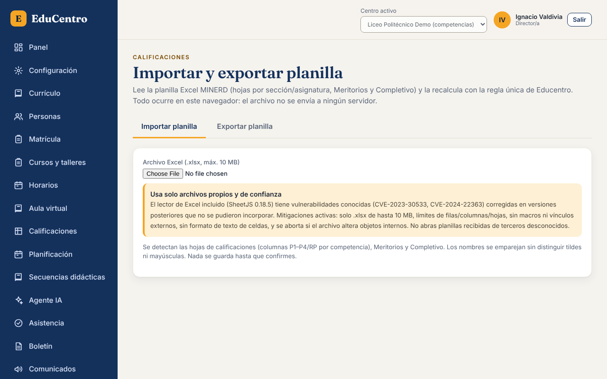

# Planilla Excel y modelo por competencias

Basado en la estructura de la planilla de calificaciones del MINERD (6.º de Secundaria, 2026-27) observada por el equipo. **El archivo y los nombres reales no se versionan** (`Educentro/datos-privados/` está ignorada por git); aquí solo se describe la estructura. Detalle en `docs/PLANTILLAS-CALIFICACION.md` y `docs/API.md` §13.

## Estructura de la planilla
- Una hoja por asignatura y sección, más `Meritorios` (cuadro de honor por sección: promedio simple de las asignaturas) y `Completivo` (estudiantes a evaluación completiva).
- 4 competencias × 4 periodos (P1–P4), cada periodo con RP (recuperación pedagógica) y columna Prom; CF; completiva (50/50), extraordinaria (30/70), especial y resultado A/R.
- Defectos observados en el original que **no se replican**: fórmulas inconsistentes por fila (solo P, mezcla P/RP), un `#REF!`, erratas y ausencia de validación. EduCentro usa una única regla ([Reglas de cálculo](Reglas-de-calculo#modelo-por-competencias-planilla-minerd)).

## Activación y libro
En **Configuración → Escala** el director elige el modelo `competencias` (con la regla de recuperación `reemplaza|maximo`, pesos de completiva y extraordinaria y nota mínima). Entonces **Calificaciones** muestra el libro por competencias:
- Grilla C1–C4 × (P1, RP1 … P4, RP4, Prom), CF, CEC/CFC, CEX/CEXF, CE, nota final y A/R, con recálculo en vivo.
- El docente edita solo los periodos abiertos (P_i y RP_i ligados al periodo i del centro); completiva, extraordinaria y especial no dependen del cierre y quedan auditadas. El director edita periodos cerrados con motivo auditado.
- Pestañas **Meritorios** (promedio simple, ranking, top N, filtro "todas aprobadas") y **Completivos** (CF < mínimo con año completo), ambas imprimibles.
- Boletín y reportes leen ambos modelos. Los datos van en la colección `notasCompetencia`.

## Importar (`#/importar-planilla`)
Director, secretaría y admin_red con un centro activo. Todo ocurre **en el navegador**; el archivo no se envía a ningún servidor.
1. Elegir un `.xlsx` (≤ 10 MB). Se detectan por contenido las hojas de calificaciones (cabecera P1/RP/Prom ×4), `Meritorios` y `Completivo`; los nombres pueden venir en columnas Apellidos+Nombres o en una sola.
2. Mapear hoja → sección/asignatura. Emparejado de estudiantes por nombre normalizado (sin tildes, mayúsculas, orden ni partículas). Crear estudiantes no encontrados (con matrícula) es opcional y requiere confirmación.
3. Se recalcula con la regla única y se muestra un **informe de discrepancias** (fórmulas solo-P o mezcla P/RP, `#REF!`, valores Prom/CF/CFC/CEXF distintos, A/R distinto, listas de completivo) sin bloquear.
4. Nada se guarda hasta confirmar; las celdas vacías no borran notas salvo que se marque "vaciar". La importación deja una entrada de auditoría `importar_planilla` con conteos, sin nombres.

## Exportar
Pestaña **Exportar planilla**: una hoja por asignatura con el mismo diseño de columnas, fórmulas idénticas en todas las filas (verificadas contra el núcleo de cálculo), columnas extra "Nota final", "Resultado" y "Periodos con nota", y hojas Meritorios/Completivo. Texto que empieza por `= + - @` se neutraliza. No conserva el formato visual del original.

## Seguridad del importador
SheetJS CE **0.18.5** está vendorizado en `js/vendor/` (licencia Apache-2.0) y tiene CVE conocidos (CVE-2023-30533, CVE-2024-22363) corregidos en 0.19.3/0.20.2. No se pudo actualizar a ≥ 0.20.3 (red bloqueada). Mitigaciones: solo `.xlsx` ≤ 10 MB con firma ZIP, ≤ 300 componentes y ≤ 60 MB descomprimidos, sin macros/ActiveX/enlaces externos; ≤ 40 hojas, 1500 filas y 120 columnas; `cellText:false`; prevalidación de `xl/styles.xml`; instantánea de prototipos antes y después de leer (si cambia, se revierte y se aborta); el contenido nunca se evalúa. **Usar solo archivos propios y de confianza.** Ver [Seguridad y privacidad](Seguridad-y-privacidad) y [Hoja de ruta](Hoja-de-ruta).

## Datos ficticios para probar
La semilla incluye `cen_3` «Liceo Politécnico Demo (competencias)»: 6.º de Secundaria, 12 estudiantes ficticios, 8 asignaturas, 4 periodos (P1–P3 cerrados, P4 abierto). `tests/planilla.test.html` usa datos ficticios.
